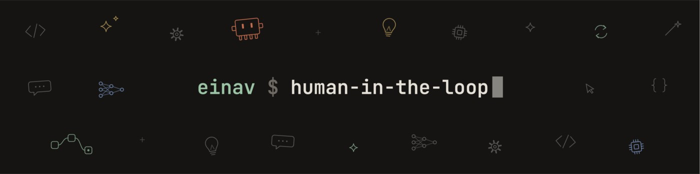

  

# Hi, I'm Einav

**I build with AI agents, and I keep a human in the loop.**

My professional world is learning and AI enablement: I help people and teams work better with AI, and I design how they learn. In my own time I build real tools, shaped around problems that bother me personally, with a team of AI agents that I orchestrate.

## What I do

- **AI enablement.** Helping teams and organizations move from occasional AI experiments to working with AI every day, through training, coaching and practical playbooks.
- **Learning and development.** E-learning, skills mapping, microlearning and AI-powered learning.
- **Building for myself.** Custom solutions for my own pain points, from the small to the complex.

## How I build with AI

- **Orchestration.** I set the goal, split the work across specialised agents (builders, reviewers, QA) and run them in parallel with Claude Code.
- **Human in the loop.** Agents work inside written autonomy rules. Anything destructive, outward-facing or hard to undo waits for a human yes.
- **Verify before "done".** A change is checked against the running app before I trust it, and an agent never reports something as sent or shipped until it has been confirmed.

## What I'm building

The scope of my projects is wide and keeps changing. As a taste, here is a glimpse of a few I'm most proud of. Each one links to a showcase page with screens, an architecture diagram and the story behind it:

- **[Pulse](https://github.com/einavtayari/pulse-showcase).** A self-hosted fitness and nutrition app, with AI advisors that remember the process over time.
- **[Eevee](https://github.com/einavtayari/eevee-showcase).** A personal assistant on Telegram that grew into a deputy agent, with autonomy rules, quiet hours, server monitoring and backups.
- **[Voilà](https://github.com/einavtayari/voila-showcase).** A French verb-conjugation practice app.

And more in the making, including a personal styling app that is still at the design stage.

These projects are private, and so are my repositories: they hold deeply personal things, solutions shaped around one person. What I'd love to learn from other builders is how to take the next step and turn a personal solution into one that helps a whole community. Meanwhile, I'm glad to walk through the architecture, the prompts and the agent setup live, in a demo or a conversation.

**What I work with:** Claude Code, multi-agent workflows, Telegram bots, web apps (PWA), self-hosting with Docker.

## Find me

Always up for a conversation about AI enablement, AI agents and human-in-the-loop design.
